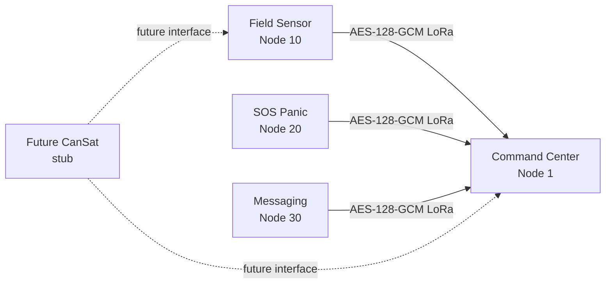

# Disaster Network

Multi-node, encrypted LoRa emergency communication firmware for ESP32-S3 nodes with SX1278 433 MHz radios.

> **Prototype status:** This repository is a working firmware baseline and build/documentation starting point. Radio-range validation, exact PCB pin freeze, power/battery design, secure key provisioning, regulatory review, and field hardening are still required before operational deployment.

## Architecture



Each frame uses a small versioned protocol containing source/destination IDs, message type, sequence number, a random 96-bit GCM nonce, encrypted payload + CRC32, and a 128-bit GCM authentication tag. The CRC is encrypted; GCM is the cryptographic integrity mechanism.

## Nodes

| Node | Default ID | Purpose | Inputs / outputs |
|---|---:|---|---|
| Command Center | 1 | Central receiver/status display | LoRa + USB serial console |
| Field Sensor | 10 | Periodic status/sensor reporting | Generic analog input GPIO15 |
| SOS Panic | 20 | Immediate emergency alert | Button GPIO17 + Morse buzzer GPIO18 |
| Messaging | 30 | Preset/custom text | 4×4 keypad |
| CanSat (planned) | TBD | Future sensor/telemetry integration | Stub interface only |

## Rev-A pin contract

The firmware/hardware interface is frozen as **Disaster Network Rev-A**. The canonical GPIO/net mapping is [`hardware/REV-A_PINOUT.md`](hardware/REV-A_PINOUT.md). The fixed LoRa bus is SCK=12, MISO=13, MOSI=11, CS=10, RESET=9, DIO0=8. Node-specific I/O is Field ADC=15; SOS button=17 and buzzer control=18; Messaging keypad rows=1,2,16,17 and columns=4,5,6,7.

`hardware/REV-A_PINOUT.md` is the source of truth for PCB bring-up. If an existing board routes MISO to a different ESP32-S3 pin, classify it as a legacy assembly and use the upload workaround rather than silently changing the Rev-A firmware contract.

## Hardware BOM

See [`hardware/BOM.md`](hardware/BOM.md). The core per-node BOM is an ESP32-S3-DevKitC-1-compatible board, SX1278 433 MHz module, matching antenna, power system, and wiring. Add the node-specific keypad, button/buzzer, or sensor as appropriate.

## Default pin map

See [`docs/pinout-notes.md`](docs/pinout-notes.md). The project defaults avoid ESP32-S3 strapping pins. Espressif identifies GPIO0, GPIO3, GPIO45 and GPIO46 as strapping pins. https://docs.espressif.com/projects/esp-idf/en/stable/esp32s3/api-reference/peripherals/gpio.html

A previously assembled board may still have LoRa MISO routed to a strapping pin. The build guide documents the resolved workaround: electrically isolate MISO while entering download/upload mode, then reconnect it for normal operation.

## Encryption and key handling

The common library uses the ESP32 framework's Mbed TLS AES-GCM implementation. The repository contains a **demo development key** only as a buildable placeholder. For real deployment:

1. Copy `firmware/common/include/disaster_secrets.h.example` to `firmware/common/include/disaster_secrets.h`.
2. Replace the 16-byte key with a securely generated unique project key.
3. Do not commit the real key; `.gitignore` excludes `disaster_secrets.h`.
4. Plan a proper per-network/per-device provisioning and rotation mechanism before field use.

## Quick start

Install PlatformIO Core or the VS Code PlatformIO extension.

```bash
git clone <your-new-repo-url>
cd disaster-network
cp firmware/common/include/disaster_secrets.h.example firmware/common/include/disaster_secrets.h
# Edit the key before deployment.

pio run -e command-center
pio run -e field-sensor-node
pio run -e sos-panic-node
pio run -e messaging-node
```

Upload one environment at a time:

```bash
pio run -e command-center -t upload
pio device monitor -b 115200
```

The PlatformIO board identifier used here is `esp32-s3-devkitc-1`. https://docs.platformio.org/en/latest/boards/espressif32/esp32-s3-devkitc-1.html

The Arduino LoRa library supports explicit NSS/reset/DIO0 pin assignment and custom SPI setup before `LoRa.begin()`, which the common radio layer uses. https://github.com/sandeepmistry/arduino-LoRa/blob/master/API.md

## First boot tests

- **Command Center:** serial console prints `LoRa ready` and then received authenticated packets.
- **Field Sensor:** sends `FIELD ONLINE` once, then an ADC report every 30 seconds.
- **SOS:** press the panic button; the node sends an SOS packet and plays `... --- ...` without blocking the main loop.
- **Messaging:** keys `1`-`8` send presets. Press `B` for custom multi-tap text; `#` sends.

## Messaging-node key behavior

Default mode:

```text
1 STATUS OK       5 TRAPPED
2 NEED WATER      6 FIRE
3 NEED MEDICAL    7 INJURED
4 EVACUATE        8 LOCATION SENT
B -> custom mode
```

Custom mode:

```text
2-9 = multi-tap letters/numbers
0   = space
*   = backspace
A   = clear
#   = send
D   = cancel
```

## Protocol specification

See [`docs/protocol.md`](docs/protocol.md) for the exact authenticated wire format and message types.

## Repository structure

```text
.
├── .gitignore
├── LICENSE
├── README.md
├── platformio.ini
├── firmware/
│   ├── common/
│   │   ├── include/
│   │   │   ├── cansat_stub.h
│   │   │   ├── disaster_config.h
│   │   │   ├── disaster_protocol.h
│   │   │   ├── disaster_radio.h
│   │   │   └── disaster_secrets.h.example
│   │   └── src/
│   │       ├── disaster_protocol.cpp
│   │       └── disaster_radio.cpp
│   ├── command-center/src/main.cpp
│   ├── field-sensor-node/src/main.cpp
│   ├── sos-panic-node/src/main.cpp
│   └── messaging-node/src/main.cpp
├── docs/
│   ├── build-guides/
│   │   ├── build-guide-en.md
│   │   └── build-guide-ar.md
│   ├── wiring-diagrams/overview.md
│   └── pinout-notes.md
├── hardware/
│   ├── BOM.md
│   └── REV-A_PINOUT.md
│   └── REV-A_PINOUT.md
```

## Development workflow

```bash
git status
git add .
git commit -m "Initial Disaster Network firmware and docs"
git branch -M main
git remote add origin <YOUR_GITHUB_URL>
git push -u origin main
```

## Known TODOs

- Verify the manufactured PCB matches the frozen Rev-A pin contract in `hardware/REV-A_PINOUT.md`.
- Replace generic analog sensor mapping with the production sensor.
- Choose and implement a physical command-center display if serial-only output is insufficient.
- Add acknowledgements/retries and a routing/repeat strategy for larger deployments.
- Add replay protection based on a persistent receive window/counter scheme for hostile environments.
- Validate power budget, thermal behavior, antenna/RF layout, and regional 433 MHz regulations.
- Implement the CanSat interface and telemetry payload when its hardware contract is finalized.
